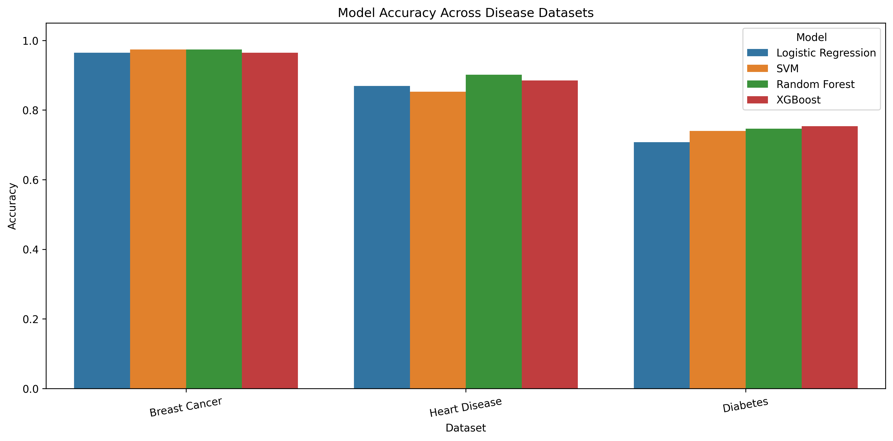
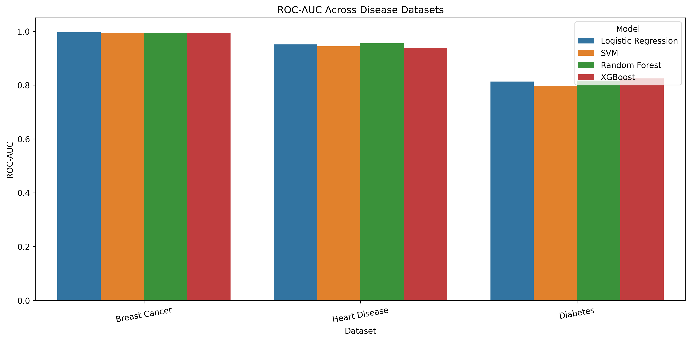
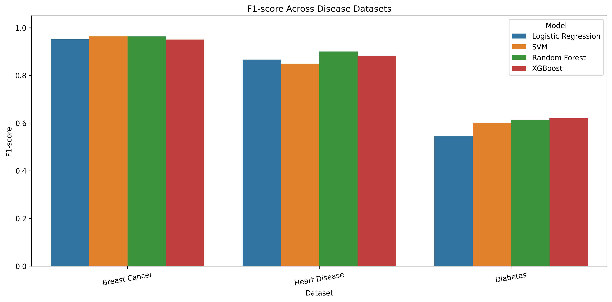
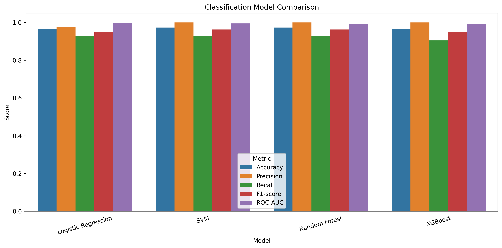
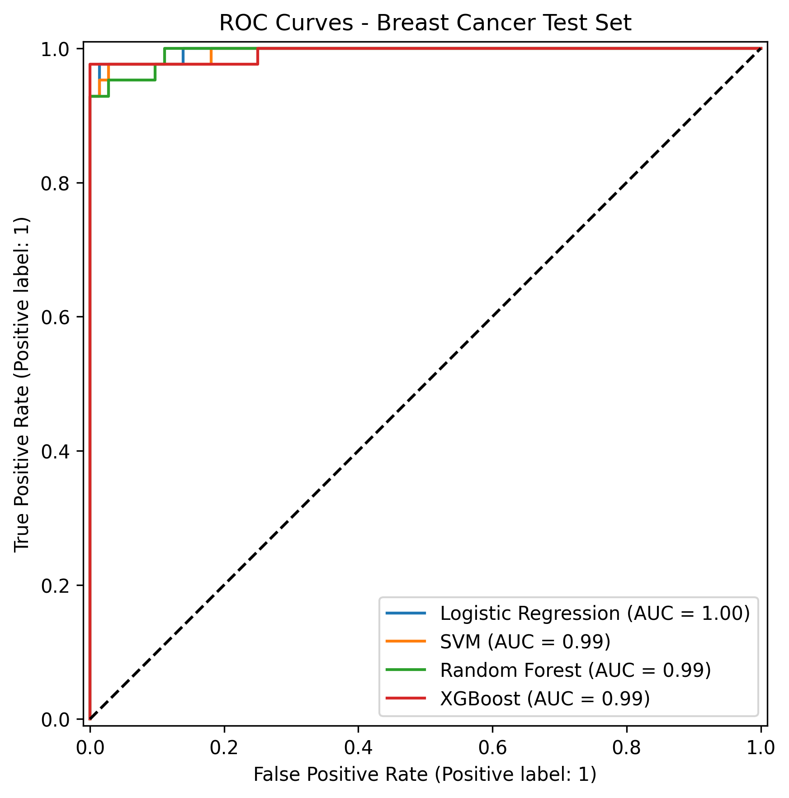
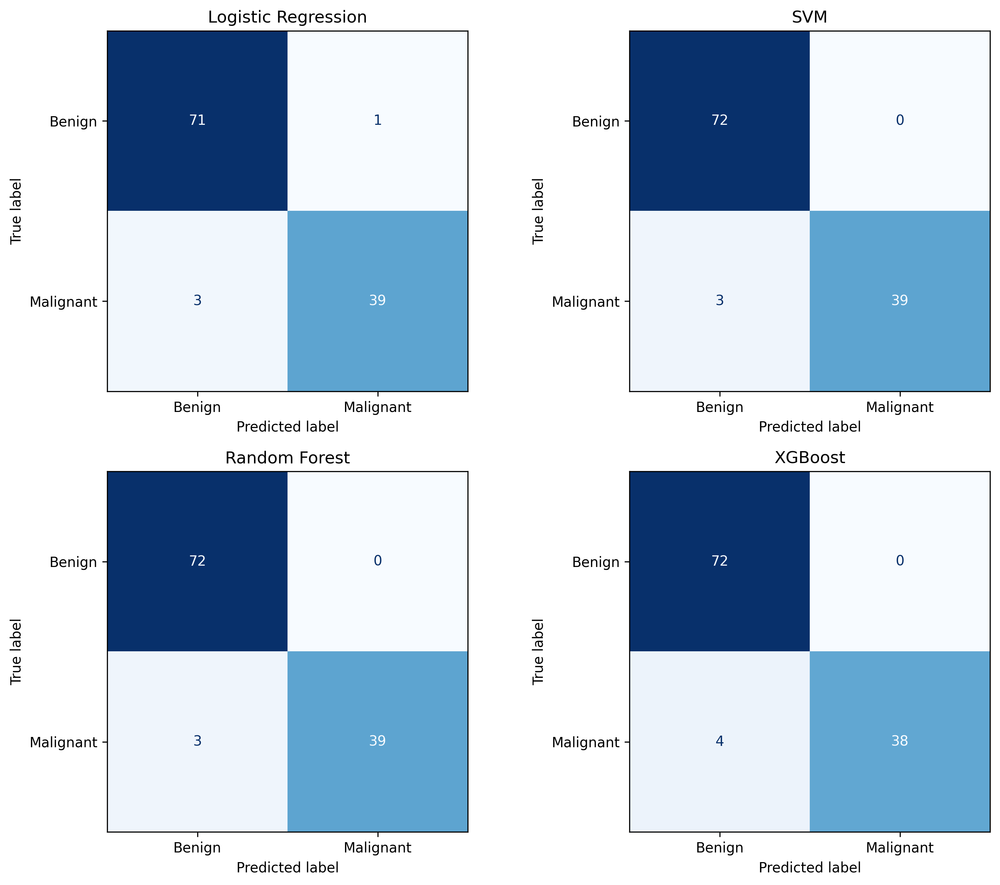

# Disease Prediction from Medical Data
### Comparative Multi-Model Benchmark across Clinical Tabular Datasets

[](https://www.python.org/)
[](https://scikit-learn.org/)
[](https://xgboost.readthedocs.io/)
[](https://pandas.pydata.org/)
[](https://numpy.org/)
[]()
[](https://github.com/Mubasshir14)

An end-to-end Machine Learning benchmarking framework evaluating four classification algorithms across three standard clinical datasets (**Breast Cancer Wisconsin Diagnostic**, **UCI Cleveland Heart Disease**, and **Pima Indians Diabetes**). Developed as part of the **CodeAlpha Machine Learning Internship**.

---

## Table of Contents
1. [Project Overview](#-project-overview)
2. [Datasets & Clinical Tasks](#-datasets--clinical-tasks)
3. [Methodology & Pipeline Architecture](#-methodology--pipeline-architecture)
4. [Comparative Benchmark Results](#-comparative-benchmark-results)
5. [Visualizations & Metric Comparisons](#-visualizations--metric-comparisons)
6. [Key Clinical Observations & Insights](#-key-clinical-observations--insights)
7. [Repository Structure](#-repository-structure)
8. [How to Run & Load Saved Models](#-how-to-run--load-saved-models)
9. [Limitations & Clinical Disclaimer](#-limitations--clinical-disclaimer)
10. [Author & Attribution](#-author--attribution)

---

## Project Overview

Early, automated detection of chronic and life-threatening conditions from physiological measurements and diagnostic imaging attributes plays a vital role in medical decision support systems. 

This repository implements a rigorous comparative study evaluating **four diverse supervised classification algorithms**:
- **Logistic Regression**: Linear baseline with L-BFGS solver and standardized feature space.
- **Support Vector Machine (SVM)**: Non-linear kernelized separation (RBF kernel) with probability estimates.
- **Random Forest Classifier**: Ensemble bagging with bootstrap aggregation and multi-tree feature subsampling.
- **XGBoost (Extreme Gradient Boosting)**: Scalable regularized gradient-boosted decision trees.

Each model was trained, cross-validated, and tested across three real-world medical diagnostic datasets to analyze classification accuracy, sensitivity (recall), false-positive rates, ROC-AUC trade-offs, and computational latency.

---

##  Datasets & Clinical Tasks

| Dataset | Observations | Features | Target Clinical Task | Positive Class | Class Ratio |
|:---|:---:|:---:|:---|:---|:---:|
| **Breast Cancer Wisconsin (Diagnostic)** | 569 | 30 | Discriminate benign vs. malignant breast tissue FNA biopsied cell nuclei | Malignant ($M$) | 357 Benign (62.7%) / 212 Malignant (37.3%) |
| **UCI Cleveland Heart Disease** | 303 | 13 | Identify coronary artery disease presence ($\ge 50\%$ diameter narrowing) | Heart Disease ($1$) | 165 Absence (54.5%) / 138 Presence (45.5%) |
| **Pima Indians Diabetes** | 768 | 8 | Predict diabetes onset based on metabolic and physiological attributes | Diabetic ($1$) | 500 Negative (65.1%) / 268 Positive (34.9%) |

### Dataset Summaries
1. **Breast Cancer Wisconsin (Diagnostic)**: Extracted from digitized images of fine needle aspirate (FNA) of breast masses. Features describe characteristics of cell nuclei: radius, texture, perimeter, area, smoothness, compactness, concavity, concave points, symmetry, and fractal dimension (mean, standard error, and worst/largest values).
2. **UCI Cleveland Heart Disease**: Key diagnostic features include age, sex, chest pain type (`cp`), resting blood pressure (`trestbps`), serum cholesterol (`chol`), fasting blood sugar (`fbs`), resting ECG (`restecg`), maximum heart rate achieved (`thalach`), exercise-induced angina (`exang`), ST depression (`oldpeak`), slope of the peak exercise ST segment (`slope`), number of major vessels (`ca`), and thalassemia defect (`thal`).
3. **Pima Indians Diabetes**: Demographic and clinical measurements including number of pregnancies, plasma glucose concentration, diastolic blood pressure, triceps skin fold thickness, 2-hour serum insulin, body mass index (BMI), diabetes pedigree function, and age.

---

## Methodology & Pipeline Architecture

```text
Raw Medical Data
       │
       ▼
Stratified Train-Test Split (80% Train / 20% Test, random_state=42)
       │
       ▼
Pipeline Preprocessing (Inside CV & Fit to prevent data leakage)
       ├── SimpleImputer (strategy='median')
       └── StandardScaler (Z-score normalization)
       │
       ▼
5-Fold Stratified Cross-Validation on Training Fold
       │
       ▼
Final Model Fit & Hold-out Evaluation on Unseen 20% Test Batch
       │
       ▼
Metric Extraction & Visualization (Accuracy, Precision, Recall, F1, ROC-AUC)
```

- **Leakage Prevention**: All imputation (median) and scaling (`StandardScaler`) transformations were constructed strictly within pipeline objects fitted on training partitions.
- **Stratified Partitioning**: Exact target class proportions were preserved across both the 80:20 test split and each of the 5 cross-validation folds (`stratify=y`, `seed=42`).
- **Comprehensive Evaluation**: Metrics tracked include hold-out **Accuracy**, **Precision**, **Recall**, **F1-Score**, **ROC-AUC**, **5-Fold CV Accuracy & ROC-AUC (mean ± std)**, and **Training Latency**.

---

## Comparative Benchmark Results

All evaluations were executed on identical hold-out test sets. The full summary is stored in [`results/all_datasets_model_comparison.csv`](results/all_datasets_model_comparison.csv).

### 1. Breast Cancer Wisconsin Diagnostic

| Classifier | Test Accuracy | Precision | Recall | F1-Score | Test ROC-AUC | 5-Fold CV Accuracy | 5-Fold CV ROC-AUC | Training Time (s) |
|:---|:---:|:---:|:---:|:---:|:---:|:---:|:---:|:---:|
| **Logistic Regression** | 0.9649 | 0.9750 | 0.9286 | 0.9512 | **0.9960** | **0.9736 (±0.015)** | **0.9958 (±0.005)** | 0.2187s |
| **SVM (RBF Kernel)** | **0.9737** | **1.0000** | **0.9286** | **0.9630** | 0.9947 | 0.9714 (±0.005) | 0.9949 (±0.005) | 0.1893s |
| **Random Forest** | **0.9737** | **1.0000** | **0.9286** | **0.9630** | 0.9944 | 0.9604 (±0.016) | 0.9880 (±0.007) | 2.5063s |
| **XGBoost** | 0.9649 | **1.0000** | 0.9048 | 0.9500 | 0.9940 | 0.9670 (±0.012) | 0.9938 (±0.004) | 0.6189s |

*SVM and Random Forest tied for the top accuracy (97.37%) with zero false positives (Precision: 1.0000), while Logistic Regression delivered the highest ROC-AUC of 0.9960.*

---

### 2. UCI Cleveland Heart Disease

| Classifier | Test Accuracy | Precision | Recall | F1-Score | Test ROC-AUC | 5-Fold CV Accuracy | 5-Fold CV ROC-AUC | Training Time (s) |
|:---|:---:|:---:|:---:|:---:|:---:|:---:|:---:|:---:|
| **Logistic Regression** | 0.8689 | 0.8125 | 0.9286 | 0.8667 | 0.9513 | **0.8264** | **0.8960** | **0.0046s** |
| **SVM (RBF Kernel)** | 0.8525 | 0.8065 | 0.8929 | 0.8475 | 0.9437 | 0.8223 | 0.8832 | 0.0094s |
| **Random Forest** | **0.9016** | **0.8438** | **0.9643** | **0.9000** | **0.9551** | 0.8139 | 0.8837 | 0.2457s |
| **XGBoost** | 0.8852 | 0.8387 | 0.9286 | 0.8814 | 0.9383 | 0.8058 | 0.8680 | 0.0255s |

*Random Forest achieved the best overall performance with **90.16% test accuracy**, **96.43% recall** (essential in cardiac diagnosis to prevent missed positive cases), and **0.9551 ROC-AUC**.*

---

### 3. Pima Indians Diabetes

| Classifier | Test Accuracy | Precision | Recall | F1-Score | Test ROC-AUC | 5-Fold CV Accuracy | 5-Fold CV ROC-AUC | Training Time (s) |
|:---|:---:|:---:|:---:|:---:|:---:|:---:|:---:|:---:|
| **Logistic Regression** | 0.7078 | 0.6000 | 0.5000 | 0.5455 | 0.8130 | **0.7882** | **0.8434** | **0.0046s** |
| **SVM (RBF Kernel)** | 0.7403 | 0.6522 | 0.5556 | 0.6000 | 0.7964 | 0.7801 | 0.8333 | 0.0356s |
| **Random Forest** | 0.7468 | 0.6596 | **0.5741** | 0.6139 | 0.8165 | 0.7736 | 0.8195 | 0.2622s |
| **XGBoost** | **0.7532** | **0.6739** | **0.5741** | **0.6200** | **0.8250** | 0.7589 | 0.8227 | 0.0251s |

*XGBoost achieved the highest test accuracy (**75.32%**), F1-Score (**0.6200**), and ROC-AUC (**0.8250**), demonstrating superior gradient tree capability on complex physiological signals.*

---

## Visualizations & Metric Comparisons

### 1. Cross-Dataset Metric Benchmarks
The figures below illustrate the comparative performance across all three clinical datasets:

#### Model Accuracy Across Disease Datasets
<p align="center">
  
</p>

#### ROC-AUC Across Disease Datasets
<p align="center">
  
</p>

#### F1-score Across Disease Datasets
<p align="center">
  
</p>

---

### 2. Breast Cancer Model Evaluation

#### Multi-Metric Classification Comparison
<p align="center">
  
</p>

#### ROC Curves on Test Set
<p align="center">
  
</p>

#### Confusion Matrices (Benign vs. Malignant)
<p align="center">
  
</p>

- **Logistic Regression**: 71 True Benign, 1 False Malignant, 3 False Benign, 39 True Malignant.
- **SVM**: 72 True Benign, 0 False Malignant, 3 False Benign, 39 True Malignant (100% precision on malignant cases).
- **Random Forest**: 72 True Benign, 0 False Malignant, 3 False Benign, 39 True Malignant.
- **XGBoost**: 72 True Benign, 0 False Malignant, 4 False Benign, 38 True Malignant.

---

## Key Clinical Observations & Insights

1. **Pathology Domain Separability**:
   - The **Breast Cancer Wisconsin** dataset demonstrated exceptionally clear linear and non-linear separability (all classifiers achieved $>96\%$ accuracy and $>0.99$ ROC-AUC).
   - In contrast, the **Diabetes** dataset proved more challenging ($70.8\% - 75.3\%$ test accuracy), illustrating physiological overlap between borderline glucose/insulin levels in pre-diabetic patients.

2. **No "One-Size-Fits-All" Algorithm**:
   - **SVM & Random Forest** dominated on Breast Cancer tissue morphology.
   - **Random Forest** provided the highest clinical sensitivity (96.43% recall) on Heart Disease symptoms.
   - **XGBoost** provided the highest discriminative power (82.50% ROC-AUC) on the Diabetes dataset.

3. **Inference & Training Efficiency**:
   - Logistic Regression and linear SVM demonstrated ultra-fast convergence times ($\approx 4-9$ ms for Heart Disease/Diabetes).
   - Random Forest required greater computational budget ($\approx 2.5$ s on Breast Cancer) due to multi-tree bagging, while remaining lightweight enough for real-time inference.

---

## 📁 Repository Structure

```text
CodeAlpha_DiseasePredictionfromMedicalData/
│
├── figures/                                    # Generated high-resolution diagnostic plots
│   ├── all_datasets_accuracy.png               # Cross-dataset accuracy comparison bar chart
│   ├── all_datasets_f1.png                     # Cross-dataset F1-score comparison bar chart
│   ├── all_datasets_roc_auc.png                # Cross-dataset ROC-AUC comparison bar chart
│   ├── confusion_matrices.png                  # 2x2 grid of confusion matrices (Breast Cancer)
│   ├── model_comparison.png                    # Multi-metric comparison bar chart (Breast Cancer)
│   └── roc_curves.png                          # ROC-AUC curves comparison (Breast Cancer)
│
├── models/                                     # Serialized scikit-learn & xgboost pipeline artifacts (.joblib)
│   ├── Breast_Cancer_Logistic_Regression.joblib
│   ├── Breast_Cancer_Random_Forest.joblib
│   ├── Breast_Cancer_SVM.joblib
│   ├── Breast_Cancer_XGBoost.joblib
│   ├── Heart_Disease_Logistic_Regression.joblib
│   ├── Heart_Disease_Random_Forest.joblib
│   ├── Heart_Disease_SVM.joblib
│   ├── Heart_Disease_XGBoost.joblib
│   ├── Diabetes_Logistic_Regression.joblib
│   ├── Diabetes_Random_Forest.joblib
│   ├── Diabetes_SVM.joblib
│   └── Diabetes_XGBoost.joblib
│
├── results/                                    # Raw and aggregated tabular metrics (CSV format)
│   ├── all_datasets_model_comparison.csv       # Complete cross-dataset metrics table
│   ├── auc_comparison.csv                      # Breast Cancer CV vs Test ROC-AUC
│   ├── cross_validation_results.csv            # 5-fold CV metrics with standard deviations
│   ├── heart_diabetes_results.csv              # Heart Disease & Diabetes evaluation results
│   └── test_results.csv                        # Breast Cancer holdout test set results
│
├── breast+cancer+wisconsin+diagnostic.zip      # Original UCI Breast Cancer Wisconsin dataset archive
├── Report.md                                   # Formal internship experimental report
└── README.md                                   # Comprehensive project documentation & guide
```

---

## How to Run & Load Saved Models

### 1. Prerequisites & Environment Setup
Clone this repository and create a Python virtual environment:

```bash
# Clone the repository
git clonehttps://github.com/Mubasshir14/CodeAlppha_Disease_Prediction_from_Medical_Data.git
cd CodeAlppha_Disease_Prediction_from_Medical_Data

# Create and activate virtual environment
# Windows:
python -m venv venv
venv\Scripts\activate

# macOS/Linux:
python3 -m venv venv
source venv/bin/activate
```

### 2. Install Required Packages
```bash
pip install numpy pandas scikit-learn xgboost matplotlib seaborn joblib
```

### 3. Loading Saved Pipeline Models for Inference
All trained models in `models/` encapsulate complete end-to-end pipelines (imputation + scaling + classifier). You can load and predict directly:

```python
import joblib
import numpy as np

# Load the trained Breast Cancer Random Forest pipeline
pipeline = joblib.load("models/Breast_Cancer_Random_Forest.joblib")

# Example raw sample (30 morphological features for Breast Cancer)
sample_input = np.random.randn(1, 30)

# Generate prediction and risk probability
prediction = pipeline.predict(sample_input)
probability = pipeline.predict_proba(sample_input)

classes = ["Benign", "Malignant"]
print(f"Predicted Diagnosis: {classes[prediction[0]]}")
print(f"Malignancy Probability: {probability[0][1]:.4f}")
```

---

## Limitations & Clinical Disclaimer

> [!IMPORTANT]
> **Educational & Benchmark Purpose Only**: This project was developed as an educational benchmarking study within the CodeAlpha Machine Learning internship. The models and pipelines presented herein are not validated for real-world clinical decision-making or direct patient diagnosis. Medical deployment requires extensive clinical trials, FDA/CE approval, external cohort validation, and human-in-the-loop expert oversight.

---

## Author & Attribution

- **Author**: **S. M. Mubasshir Al Kasshaf**
- **Internship**: Machine Learning Intern @ **CodeAlpha**
- **GitHub**: [@Mubasshir14](https://github.com/Mubasshir14)
- **Project**: Disease Prediction from Medical Data

---

## Project Overview

Early, automated detection of chronic and life-threatening conditions from physiological measurements and diagnostic imaging attributes plays a vital role in medical decision support systems. 

This repository implements a rigorous comparative study evaluating **four diverse supervised classification algorithms**:
- **Logistic Regression**: Linear baseline with L-BFGS solver and standardized feature space.
- **Support Vector Machine (SVM)**: Non-linear kernelized separation (RBF kernel) with probability estimates.
- **Random Forest Classifier**: Ensemble bagging with bootstrap aggregation and multi-tree feature subsampling.
- **XGBoost (Extreme Gradient Boosting)**: Scalable regularized gradient-boosted decision trees.

Each model was trained, cross-validated, and tested across three real-world medical diagnostic datasets to analyze classification accuracy, sensitivity (recall), false-positive rates, ROC-AUC trade-offs, and computational latency.

---

## Datasets & Clinical Tasks

| Dataset | Observations | Features | Target Clinical Task | Positive Class | Class Ratio |
|:---|:---:|:---:|:---|:---|:---:|
| **Breast Cancer Wisconsin (Diagnostic)** | 569 | 30 | Discriminate benign vs. malignant breast tissue FNA biopsied cell nuclei | Malignant ($M$) | 357 Benign (62.7%) / 212 Malignant (37.3%) |
| **UCI Cleveland Heart Disease** | 303 | 13 | Identify coronary artery disease presence ($\ge 50\%$ diameter narrowing) | Heart Disease ($1$) | 165 Absence (54.5%) / 138 Presence (45.5%) |
| **Pima Indians Diabetes** | 768 | 8 | Predict diabetes onset based on metabolic and physiological attributes | Diabetic ($1$) | 500 Negative (65.1%) / 268 Positive (34.9%) |

### Dataset Summaries
1. **Breast Cancer Wisconsin (Diagnostic)**: Extracted from digitized images of fine needle aspirate (FNA) of breast masses. Features describe characteristics of cell nuclei: radius, texture, perimeter, area, smoothness, compactness, concavity, concave points, symmetry, and fractal dimension (mean, standard error, and worst/largest values).
2. **UCI Cleveland Heart Disease**: Key diagnostic features include age, sex, chest pain type (`cp`), resting blood pressure (`trestbps`), serum cholesterol (`chol`), fasting blood sugar (`fbs`), resting ECG (`restecg`), maximum heart rate achieved (`thalach`), exercise-induced angina (`exang`), ST depression (`oldpeak`), slope of the peak exercise ST segment (`slope`), number of major vessels (`ca`), and thalassemia defect (`thal`).
3. **Pima Indians Diabetes**: Demographic and clinical measurements including number of pregnancies, plasma glucose concentration, diastolic blood pressure, triceps skin fold thickness, 2-hour serum insulin, body mass index (BMI), diabetes pedigree function, and age.

---

## Methodology & Pipeline Architecture

```text
Raw Medical Data
       │
       ▼
Stratified Train-Test Split (80% Train / 20% Test, random_state=42)
       │
       ▼
Pipeline Preprocessing (Inside CV & Fit to prevent data leakage)
       ├── SimpleImputer (strategy='median')
       └── StandardScaler (Z-score normalization)
       │
       ▼
5-Fold Stratified Cross-Validation on Training Fold
       │
       ▼
Final Model Fit & Hold-out Evaluation on Unseen 20% Test Batch
       │
       ▼
Metric Extraction & Visualization (Accuracy, Precision, Recall, F1, ROC-AUC)
```

- **Leakage Prevention**: All imputation (median) and scaling (`StandardScaler`) transformations were constructed strictly within pipeline objects fitted on training partitions.
- **Stratified Partitioning**: Exact target class proportions were preserved across both the 80:20 test split and each of the 5 cross-validation folds (`stratify=y`, `seed=42`).
- **Comprehensive Evaluation**: Metrics tracked include hold-out **Accuracy**, **Precision**, **Recall**, **F1-Score**, **ROC-AUC**, **5-Fold CV Accuracy & ROC-AUC (mean ± std)**, and **Training Latency**.

---

## Comparative Benchmark Results

All evaluations were executed on identical hold-out test sets. The full summary is stored in [`results/all_datasets_model_comparison.csv`](results/all_datasets_model_comparison.csv).

### 1. Breast Cancer Wisconsin Diagnostic

| Classifier | Test Accuracy | Precision | Recall | F1-Score | Test ROC-AUC | 5-Fold CV Accuracy | 5-Fold CV ROC-AUC | Training Time (s) |
|:---|:---:|:---:|:---:|:---:|:---:|:---:|:---:|:---:|
| **Logistic Regression** | 0.9649 | 0.9750 | 0.9286 | 0.9512 | **0.9960** | **0.9736 (±0.015)** | **0.9958 (±0.005)** | 0.2187s |
| **SVM (RBF Kernel)** | **0.9737** | **1.0000** | **0.9286** | **0.9630** | 0.9947 | 0.9714 (±0.005) | 0.9949 (±0.005) | 0.1893s |
| **Random Forest** | **0.9737** | **1.0000** | **0.9286** | **0.9630** | 0.9944 | 0.9604 (±0.016) | 0.9880 (±0.007) | 2.5063s |
| **XGBoost** | 0.9649 | **1.0000** | 0.9048 | 0.9500 | 0.9940 | 0.9670 (±0.012) | 0.9938 (±0.004) | 0.6189s |

*SVM and Random Forest tied for the top accuracy (97.37%) with zero false positives (Precision: 1.0000), while Logistic Regression delivered the highest ROC-AUC of 0.9960.*

---

### 2. UCI Cleveland Heart Disease

| Classifier | Test Accuracy | Precision | Recall | F1-Score | Test ROC-AUC | 5-Fold CV Accuracy | 5-Fold CV ROC-AUC | Training Time (s) |
|:---|:---:|:---:|:---:|:---:|:---:|:---:|:---:|:---:|
| **Logistic Regression** | 0.8689 | 0.8125 | 0.9286 | 0.8667 | 0.9513 | **0.8264** | **0.8960** | **0.0046s** |
| **SVM (RBF Kernel)** | 0.8525 | 0.8065 | 0.8929 | 0.8475 | 0.9437 | 0.8223 | 0.8832 | 0.0094s |
| **Random Forest** | **0.9016** | **0.8438** | **0.9643** | **0.9000** | **0.9551** | 0.8139 | 0.8837 | 0.2457s |
| **XGBoost** | 0.8852 | 0.8387 | 0.9286 | 0.8814 | 0.9383 | 0.8058 | 0.8680 | 0.0255s |

*Random Forest achieved the best overall performance with **90.16% test accuracy**, **96.43% recall** (essential in cardiac diagnosis to prevent missed positive cases), and **0.9551 ROC-AUC**.*

---

### 3. Pima Indians Diabetes

| Classifier | Test Accuracy | Precision | Recall | F1-Score | Test ROC-AUC | 5-Fold CV Accuracy | 5-Fold CV ROC-AUC | Training Time (s) |
|:---|:---:|:---:|:---:|:---:|:---:|:---:|:---:|:---:|
| **Logistic Regression** | 0.7078 | 0.6000 | 0.5000 | 0.5455 | 0.8130 | **0.7882** | **0.8434** | **0.0046s** |
| **SVM (RBF Kernel)** | 0.7403 | 0.6522 | 0.5556 | 0.6000 | 0.7964 | 0.7801 | 0.8333 | 0.0356s |
| **Random Forest** | 0.7468 | 0.6596 | **0.5741** | 0.6139 | 0.8165 | 0.7736 | 0.8195 | 0.2622s |
| **XGBoost** | **0.7532** | **0.6739** | **0.5741** | **0.6200** | **0.8250** | 0.7589 | 0.8227 | 0.0251s |

*XGBoost achieved the highest test accuracy (**75.32%**), F1-Score (**0.6200**), and ROC-AUC (**0.8250**), demonstrating superior gradient tree capability on complex physiological signals.*

---

## Visualizations & Metric Comparisons

### 1. Cross-Dataset Metric Benchmarks
The figures below illustrate the comparative performance across all three clinical datasets:

#### Model Accuracy Across Disease Datasets
<p align="center">
  
</p>

#### ROC-AUC Across Disease Datasets
<p align="center">
  
</p>

#### F1-score Across Disease Datasets
<p align="center">
  
</p>

---

### 2. Breast Cancer Model Evaluation

#### Multi-Metric Classification Comparison
<p align="center">
  
</p>

#### ROC Curves on Test Set
<p align="center">
  
</p>

#### Confusion Matrices (Benign vs. Malignant)
<p align="center">
  
</p>

- **Logistic Regression**: 71 True Benign, 1 False Malignant, 3 False Benign, 39 True Malignant.
- **SVM**: 72 True Benign, 0 False Malignant, 3 False Benign, 39 True Malignant (100% precision on malignant cases).
- **Random Forest**: 72 True Benign, 0 False Malignant, 3 False Benign, 39 True Malignant.
- **XGBoost**: 72 True Benign, 0 False Malignant, 4 False Benign, 38 True Malignant.

---

## Key Clinical Observations & Insights

1. **Pathology Domain Separability**:
   - The **Breast Cancer Wisconsin** dataset demonstrated exceptionally clear linear and non-linear separability (all classifiers achieved $>96\%$ accuracy and $>0.99$ ROC-AUC).
   - In contrast, the **Diabetes** dataset proved more challenging ($70.8\% - 75.3\%$ test accuracy), illustrating physiological overlap between borderline glucose/insulin levels in pre-diabetic patients.

2. **No "One-Size-Fits-All" Algorithm**:
   - **SVM & Random Forest** dominated on Breast Cancer tissue morphology.
   - **Random Forest** provided the highest clinical sensitivity (96.43% recall) on Heart Disease symptoms.
   - **XGBoost** provided the highest discriminative power (82.50% ROC-AUC) on the Diabetes dataset.

3. **Inference & Training Efficiency**:
   - Logistic Regression and linear SVM demonstrated ultra-fast convergence times ($\approx 4-9$ ms for Heart Disease/Diabetes).
   - Random Forest required greater computational budget ($\approx 2.5$ s on Breast Cancer) due to multi-tree bagging, while remaining lightweight enough for real-time inference.

---

## Repository Structure

```text
CodeAlpha_DiseasePredictionfromMedicalData/
│
├── figures/                                    # Generated high-resolution diagnostic plots
│   ├── all_datasets_accuracy.png               # Cross-dataset accuracy comparison bar chart
│   ├── all_datasets_f1.png                     # Cross-dataset F1-score comparison bar chart
│   ├── all_datasets_roc_auc.png                # Cross-dataset ROC-AUC comparison bar chart
│   ├── confusion_matrices.png                  # 2x2 grid of confusion matrices (Breast Cancer)
│   ├── model_comparison.png                    # Multi-metric comparison bar chart (Breast Cancer)
│   └── roc_curves.png                          # ROC-AUC curves comparison (Breast Cancer)
│
├── models/                                     # Serialized scikit-learn & xgboost pipeline artifacts (.joblib)
│   ├── Breast_Cancer_Logistic_Regression.joblib
│   ├── Breast_Cancer_Random_Forest.joblib
│   ├── Breast_Cancer_SVM.joblib
│   ├── Breast_Cancer_XGBoost.joblib
│   ├── Heart_Disease_Logistic_Regression.joblib
│   ├── Heart_Disease_Random_Forest.joblib
│   ├── Heart_Disease_SVM.joblib
│   ├── Heart_Disease_XGBoost.joblib
│   ├── Diabetes_Logistic_Regression.joblib
│   ├── Diabetes_Random_Forest.joblib
│   ├── Diabetes_SVM.joblib
│   └── Diabetes_XGBoost.joblib
│
├── results/                                    # Raw and aggregated tabular metrics (CSV format)
│   ├── all_datasets_model_comparison.csv       # Complete cross-dataset metrics table
│   ├── auc_comparison.csv                      # Breast Cancer CV vs Test ROC-AUC
│   ├── cross_validation_results.csv            # 5-fold CV metrics with standard deviations
│   ├── heart_diabetes_results.csv              # Heart Disease & Diabetes evaluation results
│   └── test_results.csv                        # Breast Cancer holdout test set results
│
├── breast+cancer+wisconsin+diagnostic.zip      # Original UCI Breast Cancer Wisconsin dataset archive
├── Report.md                                   # Formal internship experimental report
└── README.md                                   # Comprehensive project documentation & guide
```

---

## How to Run & Load Saved Models

### 1. Prerequisites & Environment Setup
Clone this repository and create a Python virtual environment:

```bash
# Clone the repository
git clone https://github.com/Mubasshir14/CodeAlpha_DiseasePredictionfromMedicalData.git
cd CodeAlpha_DiseasePredictionfromMedicalData

# Create and activate virtual environment
# Windows:
python -m venv venv
venv\Scripts\activate

# macOS/Linux:
python3 -m venv venv
source venv/bin/activate
```

### 2. Install Required Packages
```bash
pip install numpy pandas scikit-learn xgboost matplotlib seaborn joblib
```

### 3. Loading Saved Pipeline Models for Inference
All trained models in `models/` encapsulate complete end-to-end pipelines (imputation + scaling + classifier). You can load and predict directly:

```python
import joblib
import numpy as np

# Load the trained Breast Cancer Random Forest pipeline
pipeline = joblib.load("models/Breast_Cancer_Random_Forest.joblib")

# Example raw sample (30 morphological features for Breast Cancer)
sample_input = np.random.randn(1, 30)

# Generate prediction and risk probability
prediction = pipeline.predict(sample_input)
probability = pipeline.predict_proba(sample_input)

classes = ["Benign", "Malignant"]
print(f"Predicted Diagnosis: {classes[prediction[0]]}")
print(f"Malignancy Probability: {probability[0][1]:.4f}")
```

---

## Limitations & Clinical Disclaimer

> [!IMPORTANT]
> **Educational & Benchmark Purpose Only**: This project was developed as an educational benchmarking study within the CodeAlpha Machine Learning internship. The models and pipelines presented herein are not validated for real-world clinical decision-making or direct patient diagnosis. Medical deployment requires extensive clinical trials, FDA/CE approval, external cohort validation, and human-in-the-loop expert oversight.

---

## Author & Attribution

- **Author**: **S. M. Mubasshir Al Kasshaf**
- **Internship**: Machine Learning Intern @ **CodeAlpha**
- **GitHub**: [@Mubasshir14](https://github.com/Mubasshir14)
- **Project**: Disease Prediction from Medical Data

---

<p align="center">
  <b>Developed by S. M. Mubasshir Al Kasshaf | CodeAlpha ML Internship</b>
</p>

